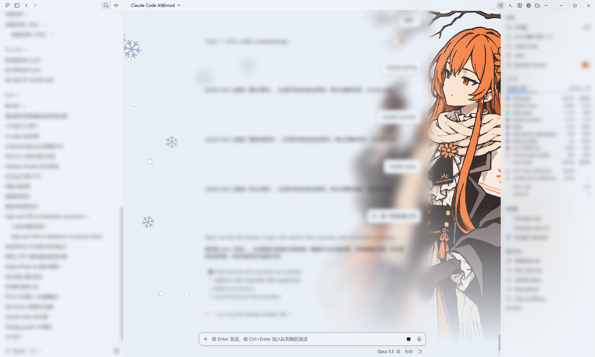
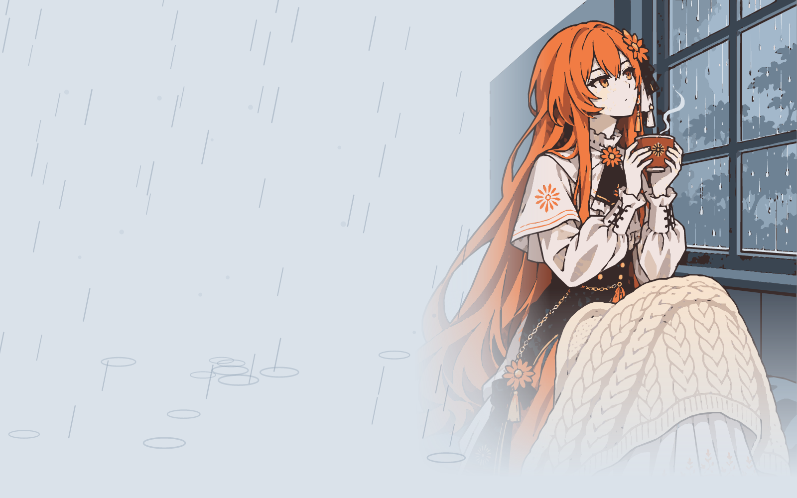

# xiaoke-look · 小克主题

给 Claude 桌面端 Code 标签用的主题 mod：五套「小克」（Claude 娘）主题，每套有自己的配色和一张插画。插画贴在窗口右上角，向左、向下渐变淡出成留白，空白处有很慢的花瓣、星光、雨丝或雪花。

A Claude Code mod with five Claude-chan looks for the desktop app's Code tab. Each has its own palette and an illustration pinned to the top right that fades into blank paper toward the left and the bottom.



## 主题 / Looks

| 名字 | 主题 | 模式 | 预览 |
| --- | --- | --- | --- |
| `afternoon` | 午后·窗边读书 | 浅色 |  |
| `night` | 夜读·台灯 | 深色 |  |
| `code` | 深夜·敲代码 | 深色 |  |
| `rain` | 雨天·窗边茶 | 浅色 |  |
| `snow` | 冬日·初雪 | 浅色 |  |

切换：在会话里输入 `/xiaoke night`（也认中文名，如 `/xiaoke 夜读`）；不带参数的 `/xiaoke` 列出全部。选择会被记住，之后新开的会话也用它。默认是 `afternoon`。

Switch with `/xiaoke <name>`; `/xiaoke` alone lists them. The choice is remembered for later sessions.

每套主题只有一种模式（插画本身是亮的或暗的），会覆盖应用自己的浅色/深色设置。Each look is made for one mode and sets it.

**右侧栏让位。** 桌面端的侧栏是实心的，会盖住贴在窗口右边的插画。常开右侧栏的话，输入 `/xiaoke 右栏`，插画会往左让出 320px；`/xiaoke 右栏 280` 设成别的宽度，再输一次 `/xiaoke 右栏` 关掉。The app draws its side panels opaque; `/xiaoke panel` keeps the picture 320 px clear of the right edge (`/xiaoke panel <px>` for another width, again to turn it off).

## 安装 / Install

在终端里的 Claude Code 会话输入（At the prompt of a terminal session）:

```
/plugin install xiaoke-look --marketplace bananaeat/xiaoke-look
```

先回答 `y` 添加 marketplace，再选 user scope。装好后，之后新开的会话（包括桌面端 Code 标签的本地会话）都会加载它。

From a shell:

```
claude plugin install xiaoke-look --marketplace bananaeat/xiaoke-look
```

桌面端里 `/plugin` 不能用：点输入框旁的 **+** → Plugins → Add marketplace，填 `bananaeat/xiaoke-look`，再 Add plugin。
In the desktop app, where `/plugin` does not run: click **+** next to the prompt box, then Plugins, Add marketplace with `bananaeat/xiaoke-look`, then Add plugin.

需要能显示 mod 主题的 Claude 桌面端（在 Claude Code 2.1.326 上测试过）。终端和编辑器里不显示主题。
Needs a Claude desktop app that draws mod looks (tested with Claude Code 2.1.326); terminals and editors draw no look.

## 说明 / Notes

- **背景是纯矢量。** 桌面端的背景只接受纯矢量 SVG（不能嵌位图，最多 131072 字符），所以每张原画（`docs/scenes/*.png`）都被描摹成了 6.6 万到 12 万字符的平涂色块 SVG。The backdrops are pure vector: each painting was traced into flat-ink paths under the 131,072-character limit.
- 开启"减少动态"时飘落物静止。Particles rest in place under reduced motion.

## 自己重新描摹 / Rebuilding a scene

`tools/` 里是描摹流程（Python 3，需要 numpy、opencv-python、resvg-py）。浅色场景：

```
python tools/trace.py docs/scenes/rain.png vec.json --scale 1.0 --colors 20 --eps 1.0 --minarea 9 --crop 0,0,1024,1200 --paper "#dce2e9"
python tools/build_scene.py vec.json hooks/scenes/rain.ts --preview preview.svg --fx rain
python tools/render.py preview.svg preview.png 1600
```

深色场景加 `--dark-thr 0 --line-drop 30 --line-max 70`（只按"比周围暗"来认线稿）。

思路：先把人物剪影整个铺成描线色，再把各色块盖上去，线稿就是色块之间留下的缝；色块会向外扩半个像素来补缝，但不会盖住线稿像素。`tools/prompts/` 是生成原画用的提示词。

## 致谢与授权 / Credits & license

- Claude 娘的角色设计来自 **ZipZipPipe** 的同人设定。这是粉丝自制作品，与 Anthropic 无关。Character design after ZipZipPipe's fan design of Claude-chan; fan work, not affiliated with Anthropic.
- 代码以 MIT 协议发布（见 `LICENSE`）。插画（`docs/` 里的图、`hooks/scenes/` 里的图形）请仅作非商业用途。Code is MIT; please keep the artwork non-commercial.
- `hooks/make-colors.js` 来自 Claude Code 的 plugin-authoring 工具，用来生成设计系统的配色。
